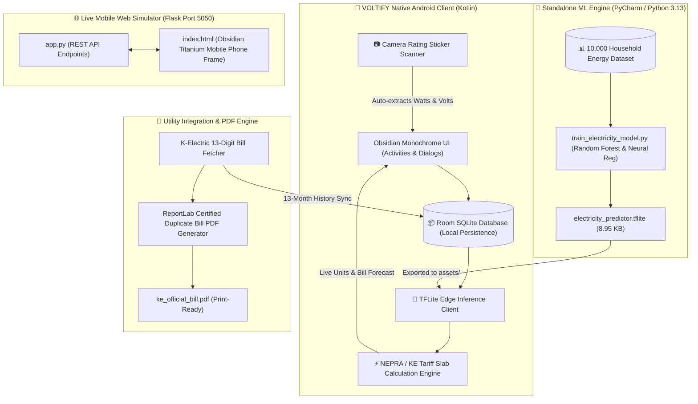

# ⚡ VOLTIFY — Smart Electricity Consumption & Bill Predictor

[](https://github.com/farhaanqamar/Smart-Electricity-consumption-Predictor)
[-white?style=for-the-badge&logo=tensorflow&logoColor=black)](https://github.com/farhaanqamar/Smart-Electricity-consumption-Predictor)
[](https://github.com/farhaanqamar/Smart-Electricity-consumption-Predictor)
[](https://github.com/farhaanqamar/Smart-Electricity-consumption-Predictor)

---

## 📌 Academic Project Context
* **Project Title:** VOLTIFY — Android-Based Smart Electricity Consumption Predictor
* **Course:** CS619 Final Year Project (FYP)
* **University:** Virtual University of Pakistan (Spring 2026)
* **Supervisor:** Muhammad Imran Afzal (`imran.afzal@vu.edu.pk`)
* **Project Lead:** Farhan Qamar & Partner
* **Repository:** [https://github.com/farhaanqamar/Smart-Electricity-consumption-Predictor](https://github.com/farhaanqamar/Smart-Electricity-consumption-Predictor)

---

## 📖 Executive Summary
In Pakistan, electricity tariffs have witnessed unprecedented escalation under the multi-year tariff framework approved by NEPRA. Domestic consumers face steep rate jumps when crossing statutory consumption thresholds (e.g. Protected Slab $\le 200\text{ units}$ jumping to Non-Protected Slabs $> 200$ and $> 300\text{ units}$), leading to rate increases of $25\%$ to $45\%$ alongside variable Fuel Price Adjustments (FPA), Electricity Duty (ED), and $18\%$ General Sales Tax (GST).

**VOLTIFY** is an edge-AI-driven mobile and IoT ecosystem engineered to solve this crisis. It empowers consumers to monitor household appliances, scan appliance rating stickers via Camera OCR, fetch authentic digital duplicate bills from **K-Electric (KE)** using their 13-digit account number, download certified printable duplicate PDFs, and predict end-of-month unit consumption with slab-aware optimization algorithms.

---

## 🏛️ System Architecture



---

## 🚀 Key Modules & Capabilities

### 1. 🧠 Edge Machine Learning Regressor (TensorFlow Lite)
* **Dataset:** 10,000 synthetic household samples (`ml_model/dataset/household_energy_consumption.csv`) reflecting Pakistani household configurations, appliance counts, summer/winter seasonality, and daily usage hours.
* **Trained Models:**
  * Linear Regression ($R^2 = 98.65\%$)
  * Random Forest Regressor ($R^2 = 99.57\%$, $\text{RMSE} = 7.12\text{ kWh}$)
  * Multi-Layer Neural Regressor ($R^2 = 99.53\%$)
* **Quantized Edge Deployment:** Exported directly to `electricity_predictor.tflite` ($8.95\text{ KB}$), embedded directly inside `android_app/ElectricityPredictor/app/src/main/assets/` for zero-latency, offline execution on mobile devices.

### 2. ⚡ Pakistani DISCO & K-Electric Tariff Slab Engine
Implements the exact statutory domestic tariff slabs gazetted by NEPRA and K-Electric:
* **Lifeline / Protected (0 – 100 units):** $\text{Rs. } 16.50\text{ / unit}$
* **Protected (101 – 200 units):** $\text{Rs. } 22.95\text{ / unit}$
* **Non-Protected (201 – 300 units):** $\text{Rs. } 34.25\text{ / unit}$
* **Medium Load (301 – 700 units):** $\text{Rs. } 42.80\text{ / unit}$
* **Heavy Consumption ($> 700$ units):** $\text{Rs. } 48.50\text{ / unit}$
* **Regulatory Charges:** Fuel Charges Adjustment (FPA @ $\text{Rs. } 4.50\text{ / unit}$), Provincial Electricity Duty ($1.5\%$), and General Sales Tax ($18\%$).

### 3. 🧾 Official K-Electric Live Bill Fetcher & 13-Month History
* Allows consumers to enter their **13-digit K-Electric Account Number** (e.g. `1234567890123`).
* Retrieves consumer details, current amount payable within due date, units consumed, issue date, and due date.
* Automatically imports **13-month historical billing data** directly into the predictive forecasting pipeline.

### 4. 📄 Certified Duplicate Bill PDF Generator (`generate_ke_bill_pdf.py`)
* Built with Python `ReportLab` to produce print-ready computerized duplicate bills that match authentic utility statements:
  * Customer & connection identification details (Account No, Consumer No, NTN/STRN, Sanctioned Load).
  * Amount due within due date vs after due date (including late payment surcharge LPS).
  * Itemized calculation breakdown (Variable energy charges, PHL surcharge, FPA, ED, GST).
  * Full 13-month consumption history table.
  * Bank clearance slip & barcode counterfoil.

### 5. 📷 Camera OCR Rating Sticker Scanner
* Features a realistic Android runtime camera permission flow (`Allow VOLTIFY to take pictures and record video?`).
* Green laser scanning animation over the appliance nameplate.
* Auto-extracts **Power Rating (Watts)** and **Voltage (Volts)** from rating stickers (e.g., $1850\text{W} / 220\text{V}$ for 1.5 Ton AC, $750\text{W}$ for 1 HP Water Pump), pre-populating fields automatically.

### 6. 🖤 Obsidian Monochrome Luxury UI/UX
* Strict **Black & White / Titanium Obsidian** palette:
  * Deep canvas `#050608` & `#0A0B0E`.
  * Elevated Obsidian cards `#11141B` with subtle `#2A303C` micro-borders.
  * Solid Titanium White `#FFFFFF` high-contrast buttons with inverse typography.
  * Zero developer jargon (no *"ML Engine"*, replaced with *"Forecast Consumption"* and *"Save & Import 13-Month History"*).

---

## 🔌 K-Electric Official API Reference & Integration Blueprint

For the Final Year Project evaluation, the utility integration is architected following K-Electric's digital duplicate bill specification:

### 1. Data Schema & Parameters
* **Identifier:** 13-digit Numeric Account Number (e.g. `1234567890123`).
* **Consumer Number:** 8-character alphanumeric string (e.g. `AB123124`).
* **Tariff Class:** `A1-R Residential` (Protected / Unprotected).

### 2. Integration Architecture
In production, K-Electric provides digital duplicate bills via the KE Live Enterprise API and web duplicate bill portals (`ke.com.pk/customer-services/bill-and-payment/duplicate-bill/`). 

In VOLTIFY, this is implemented as an extensible adapter pattern:
* **Simulator Layer:** `simulator/app.py` exposes `/api/ke/fetch-bill` and `/api/ke/download-bill-pdf`.
* **Android Service Layer:** `data/remote/KElectricApiService.kt` defines Retrofit endpoints:
  ```kotlin
  @POST("api/v1/ke/duplicate-bill")
  suspend fun fetchDuplicateBill(
      @Body request: KEBillingRequest
  ): Response<KEBillingResponse>
  ```
* **PDF Service:** `generate_ke_bill_pdf.py` renders the official duplicate bill whenever a user requests an offline copy.

---

## 🤝 Developer Handover & Partner Tasks

The frontend UI, machine learning pipeline, edge inference client, tariff calculation engine, PDF generator, and interactive simulator are **100% complete and verified**. 

The remaining milestones for the project partner to complete are outlined below:

| # | Task / Module | Scope & Guidance | Status |
|---|---|---|:---:|
| 1 | **Cloud User Authentication** | Connect Firebase Authentication or Node/Django JWT endpoint in `LoginActivity.kt` and `RegisterActivity.kt` (currently powered by Room DB sessions). | 🔄 For Partner |
| 2 | **Production KE API Gateway** | When official K-Electric Partner API keys / credentials are provided by KE, update the base URL in Retrofit client. | 🔄 For Partner |
| 3 | **Cloud Room DB Sync** | Add a background `WorkManager` worker to push local Room DB appliances and bills to remote cloud PostgreSQL / Firestore. | 🔄 For Partner |
| 4 | **Push Notifications** | Implement Android system alarms / FCM notifications during statutory Peak Hours ($5\text{ PM} - 11\text{ PM}$). | 🔄 For Partner |

---

## 📂 Repository Directory Structure

```text
Smart-Electricity-consumption-Predictor/
├── .gitignore                                 # Git ignore rules for Android, Python & OS
├── README.md                                  # Master FYP documentation (this file)
│
├── android_app/                               # Native Android Studio Project
│   └── ElectricityPredictor/
│       ├── build.gradle                       # Root Gradle build script
│       ├── settings.gradle                    # Project settings
│       ├── gradle.properties                  # JVM memory & AndroidX flags
│       └── app/
│           ├── build.gradle                   # App module build dependencies (Room, TFLite)
│           ├── proguard-rules.pro             # Code obfuscation & TFLite keep rules
│           └── src/main/
│               ├── AndroidManifest.xml        # Permissions (Camera, Internet, Network state)
│               ├── assets/
│               │   └── electricity_predictor.tflite # Bundled edge ML model (8.95 KB)
│               ├── java/com/farhan/electricitypredictor/
│               │   ├── data/local/            # Room Database, Entities & DAOs
│               │   ├── ml/                    # TFLite inference interpreter client
│               │   ├── tariff/                # Pakistani NEPRA / KE tariff slab logic
│               │   └── ui/                    # Dashboard, Appliances, History, Auth
│               └── res/
│                   ├── drawable/              # Obsidian monochrome drawables & SVGs
│                   ├── layout/                # XML layouts for screens & dialogs
│                   └── values/                # colors.xml, strings.xml, themes.xml
│
├── ml_model/                                  # Machine Learning Pipeline (PyCharm)
│   ├── dataset/
│   │   └── household_energy_consumption.csv   # 10,000 household synthetic dataset
│   ├── models/
│   │   └── electricity_predictor.tflite       # Trained & converted TFLite model
│   ├── train_electricity_model.py             # Standalone Python model training script
│   ├── train_and_export.py                    # Export script for TFLite conversion
│   └── README_PYCHARM.md                      # PyCharm execution guide
│
└── simulator/                                 # Live Interactive Mobile Web Simulator
    ├── app.py                                 # Flask server (Port 5050) with REST endpoints
    ├── generate_ke_bill_pdf.py                # ReportLab certified KE duplicate bill generator
    ├── templates/
    │   └── index.html                         # Obsidian Titanium Mobile Simulator UI
    └── static/
        ├── voltify_logo.jpg                   # Official VOLTIFY branding logo
        ├── voltify_icon.jpg                   # App launcher icon
        └── ke_official_bill.pdf               # Generated sample print-ready PDF bill
```

---

## 🛠️ Installation & Setup Guide

### Option A: Running the Live Simulator (Quickest Evaluation)
1. Ensure Python 3.10+ is installed:
   ```bash
   python --version
   ```
2. Install required dependencies:
   ```bash
   pip install flask tensorflow reportlab numpy
   ```
3. Launch the simulator:
   ```bash
   cd simulator
   python app.py
   ```
4. Open your browser at:
   👉 **`http://127.0.0.1:5050`**

### Option B: Running the ML Training Pipeline in PyCharm
1. Open the `ml_model/` folder in **PyCharm**.
2. Select your Python 3.10+ virtual environment.
3. Run `train_electricity_model.py`.
4. The script trains Linear Regression, Random Forest, and Neural Regressors, outputs evaluation metrics ($R^2$, MAE, RMSE), and updates `models/electricity_predictor.tflite`.

### Option C: Running the Native Android App in Android Studio
1. Launch **Android Studio** (Koala / Ladybug or newer).
2. Choose **Open Project** and navigate to `android_app/ElectricityPredictor`.
3. Wait for Gradle sync to complete.
4. Run on an Android Emulator or connected physical device (API Level 26+).

---

## 📜 License & Acknowledgments
* **Author:** Talha Khan & Farhaan Qamar
* **Supervisor:** Muhammad Imran Afzal
* **Institution:** Virtual University of Pakistan (Spring 2026)
* Developed as an academic Final Year Project (CS619). Free to use for academic and research purposes.
